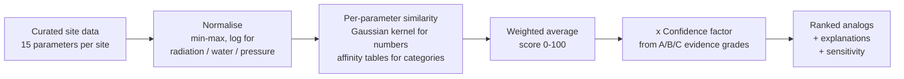
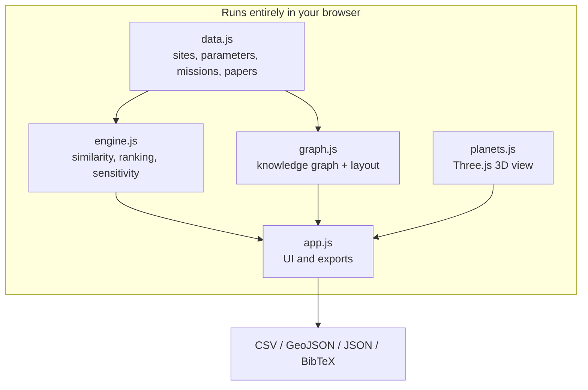

<div align="center">

# 🪐 Planetary Analog Intelligence

### Which place on Earth is most like the Moon or Mars, and why?

An interactive, browser-based explorer that ranks Earth analog sites against lunar and Martian targets using a transparent, explainable similarity model.

[](https://nasa-hackathon-20.vercel.app/)


**26 sites · 15 parameters · 94-node knowledge graph · 4 export formats**

[🚀 Live demo](https://nasa-hackathon-20.vercel.app/) · [Quick start](#-quick-start) · [How it works](#-how-it-works) · [Example results](#-example-results) · [Limitations](#-be-honest-what-this-is-not)

</div>

> *Independent hackathon project. Not affiliated with, endorsed by, or certified by NASA, ESA, ISRO or any space agency.*

---

## 🌍 The idea

Before a rover or astronaut goes to the Moon or Mars, teams test equipment in places on Earth that resemble those worlds, called **planetary analogs**: an impact crater in India, a frozen desert in Ladakh, the dry valleys of Antarctica.

But "similar" is slippery. A site can match Mars in temperature and fail in rock type, or match the Moon in radiation and fail in terrain. This project makes that comparison **visible**: pick a target on the Moon or Mars, get ranked Earth candidates, and see exactly which properties drive each match.

## ✨ What you can do

| | Feature | What it does |
|---|---|---|
| 🎯 | **Analog ranking** | Pick a lunar or Martian site and get Earth sites ranked by confidence-adjusted similarity |
| 🔍 | **Explainable scores** | See per-parameter contributions, evidence grades and missing data for any pair |
| 🎚️ | **Adjustable weights** | Decide what matters and watch rankings change |
| 📊 | **Sensitivity analysis** | Check how stable the top result is when each weight is scaled ×0.5 and ×1.5, plus a per-pair "tornado" view |
| 📍 | **Twin Finder** | Enter custom Earth coordinates and compute similarity against a chosen Moon or Mars target |
| 🕸️ | **Knowledge graph** | Explore 94 linked nodes: sites, missions, instruments, observations, papers, datasets |
| 🌌 | **3D solar-system view** | Sun, Earth, Moon and Mars in WebGL with site markers |
| 🧭 | **Exploration score** | A heuristic 8-criterion "opportunity" score (access, hazard, radiation, data availability and more) |
| 🛠️ | **Mission Test Planner** | Generates a catalog-based site suitability assessment for objectives such as rover mobility or drilling. Advisory only; access, permits and safety need local verification |
| 🖨️ | **Field dossier** | Print/PDF-ready dossier for a selected site |
| 📦 | **Exports** | Catalog as CSV and GeoJSON, graph as JSON, references as BibTeX |

## 🚀 Quick start

**Try it online:** <https://nasa-hackathon-20.vercel.app/>

**Or run locally.** No install, no build, no accounts:

```bash
git clone https://github.com/Prerana-the-coder/Nasa-Hackathon-2.0.git
cd Nasa-Hackathon-2.0
python3 -m http.server 8000
```

Then open **http://localhost:8000**. (Internet is needed for the 3D library, fonts and photos.)

<!-- Add a screenshot or GIF here once you have one:

-->

## 🧠 How it works



**In plain words**

1. Every site has values for 15 properties: temperature, pressure, radiation, water indicator, slope, dust, albedo, solar flux, ozone, precipitation, elevation, geology, morphology, hydrology and atmosphere.
2. Numbers are rescaled to 0-1 so different units can be compared.
3. Each property gets a similarity from 0 to 1. For numbers, closer means higher. For categories such as rock type, a hand-made table says how alike two types are.
4. Properties are weighted (geology counts most, ozone least) and averaged into a 0-100 score.
5. Every value carries an evidence grade (A, B or C). Weaker or missing evidence **lowers** the score, and missing data is never treated as a match. Because the best grade is 0.9, **a final score cannot exceed 90**.
6. Properties that do not apply to a world (rain on the Moon) are left out.

<details>
<summary><b>The math (for the curious)</b></summary>

```
t(x) = x                       or  log10(x + offset)   (rad, water, pres, precip)
z    = (t(x) - lo) / (hi - lo)                          min-max over all 26 sites

numeric similarity:      s = exp( -(|zA - zB| / sigma)^2 ),  sigma = 0.35
categorical similarity:  s = curated affinity in [0,1]  (1 if identical)

raw      = 100 * sum(w_i * s_i) / sum(w_i)              over parameters known in both sites
c_i      = min(conf(gradeA), conf(gradeB))              A = 0.90, B = 0.70, C = 0.45
kappa    = sum(w_i * c_i) / sum(w_i, incl. missing)
adjusted = raw * kappa
```

Cosine similarity and Euclidean distance are also computed for each pair, but they are informational and not part of the score. Source: `engine.js`.
</details>

## 📈 Example results

Top Earth analog for selected targets, using the **default weights** and the project's own engine:

| Target | Best Earth analog | Adjusted score |
|---|---|---|
| Meridiani Planum (Mars) | Rann of Kutch, India | 41.7 |
| Gale Crater (Mars) | Mars Desert Research Station, USA | 38.8 |
| Jezero Crater (Mars) | Lonar Crater, India | 36.8 |
| Mare Tranquillitatis (Moon) | Deccan Traps, India | 26.3 |
| Shackleton Crater (Moon) | Haughton Crater, Canada | 20.2 |

Scores are modest by design: the model penalises missing and low-grade data, and no Earth site matches the Moon or Mars on every property. Rankings are a way to **explore trade-offs**, not a verdict.

## 🧱 Architecture



```
├── index.html   page layout
├── data.js      curated catalog (sites, parameters, datasets, missions, papers, edges)
├── engine.js    similarity, ranking, sensitivity, exploration scoring
├── graph.js     knowledge-graph construction, layouts, SVG rendering
├── planets.js   Three.js solar-system view (procedural textures)
├── app.js       UI logic, assistant panel, planner, exports
├── style.css    main styles
└── planets.css  3D view styles
```

Deployed as a static site on Vercel. There is no backend or database.

## 🛠️ Built with

**JavaScript · HTML · CSS · Three.js (WebGL) · custom SVG graph rendering · Vercel (hosting).** No framework, no bundler, no backend, zero npm dependencies.

## ⚠️ Be honest: what this is NOT

<table>
<tr><td>

- **The data is a small, hand-curated sample.** The app does **not** pull live data from NASA, ESA, ISRO or USGS.
- **Scores are not scientifically validated.** Weights and category tables are the team's choices.
- **High similarity does not mean equivalence.** Earth cannot copy lunar or Martian gravity, vacuum or radiation.
- **The "AI assistant" is a demo.** It matches keywords and returns prepared text. It is not a language model.
- **CSV and GeoJSON exports are partly broken** (some blank or "undefined" columns). Known issue.
- **Some on-page labels are out of date:** parts of the interface say "14 Terrestrial Analogs", but the catalog contains 17 Earth sites.
- Some values are body-wide approximations (for example one lunar radiation measurement reused for all lunar sites), and mission statuses may be out of date.
- The 3D scene uses generated textures, not real planetary imagery.

</td></tr>
</table>

## 📚 Data and references

Values were compiled by the team into `data.js` with reference to published literature and mission descriptions, including NASA PDS instruments (MOLA, CRISM, LOLA, Diviner, MSL RAD/REMS/DAN), ISRO Chandrayaan-1/3, Chang'e-4, and Earth products (SRTM, MODIS, GPM IMERG). The catalog also lists 13 papers (for example Squyres et al. 2004 on Meridiani Planum and Hassler et al. 2014 on Mars radiation). Dataset names and identifiers are **cited, not ingested**, and have not been independently verified. Use the BibTeX export for the reference list.

## 🔭 Roadmap

- [x] Live deployment
- [ ] Ingest verified NASA PDS and Earthdata products with per-value provenance
- [ ] Uncertainty quantification
- [ ] Validate scores against expert-identified analog pairs
- [ ] Fix CSV and GeoJSON export fields and on-page site counts
- [ ] GIS and remote-sensing processing
- [ ] Real imagery and ephemerides in the 3D view
- [ ] Automated tests
- [ ] Add an open-source license

## 👥 Team

| Name | GitHub |
|---|---|
| Prerana Sharma | [@Prerana-the-coder](https://github.com/Prerana-the-coder) |
| greentigerbh | [@greentigerbh](https://github.com/greentigerbh) |
| suhani25singh | [@suhani25singh](https://github.com/suhani25singh) |
| Jashandeep Singh | [@JashanDX](https://github.com/JashanDX) |

*Built for the [NASA Space Apps Challenge 2026, Haldwani](https://www.spaceappschallenge.org/2026/local-events/haldwani/). Participation does not imply NASA endorsement.*

## 📄 License

No license file is currently included, so default copyright applies. Add a `LICENSE` file (for example MIT) to let others reuse the code.

---

<div align="center">

*Educational prototype. Not for mission, safety or site-selection decisions.*

⭐ If this helped you understand planetary analogs, consider starring the repo.

</div>
